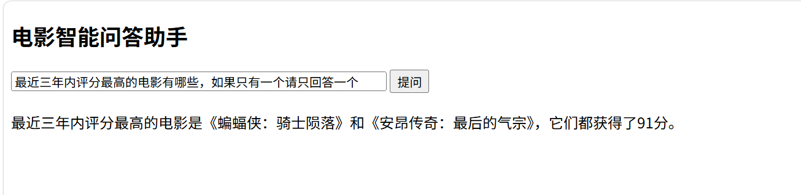

# 电影数据采集与可视化分析

基于 TMDB 高分电影榜单，用 Python 完成「数据采集 → 数据清洗 → 统计分析 → 可视化出图」的完整链路。

> 数据来源：TMDB（themoviedb.org）公开榜单，仅用于技术学习。

## 项目效果


## 实现功能

- **数据采集**：爬取 TMDB 高分榜前 100 部电影，抓取片名、评分、年份、上映日期、时长、语言、标签共 7 个字段
- **数据清洗**：缺失值填充、日期格式提取、时长换算为分钟、异常值归类
- **统计分析**：按年份、语言、标签、评分四个维度做分布统计
- **可视化**：一张 2×2 画布输出以下四张图，并自动保存为图片

  | 位置 | 图表 | 内容 |
  |---|---|---|
  | 左上 | 折线图 | 每年高分电影数量占比 |
  | 右上 | 柱状图 | 不同电影语言数量占比 |
  | 左下 | 柱状图 | 不同电影标签数量占比 |
  | 右下 | 饼状图 | 不同电影评分占比 |

## 技术栈

| 用途 | 库 |
|---|---|
| 网络请求 | requests |
| 页面解析 | lxml |
| 数据清洗与分析 | pandas |
| 数据可视化 | matplotlib |
| Web 服务 | fastapi + uvicorn |

## AI 问答助手（大模型 API 应用）

在原有数据分析的基础上，用 **FastAPI + 智谱 GLM-4（glm-4-flash）** 实现了一个 AI 问答页面：将本地评分前 10 的电影数据拼入 Prompt，模型基于真实数据回答用户提问。



**实现要点**

- **大模型 API 对接**：用 `requests` POST 调用智谱 `chat/completions` 接口；API Key 从本地 `key.txt` 读取，该文件已被 `.gitignore` 排除，不会进入仓库
- **Prompt 构建**：用 pandas 筛出评分 Top10（片名 / 评分 / 标签）拼进上下文，让模型基于本地真实数据回答，而不是凭空编造
- **前后端联调**：页面用 `fetch` 发送 POST JSON 请求到 FastAPI 的 `/ask` 接口，拿到返回的 JSON 渲染到页面
- **本地部署**：`uvicorn` 启动服务，浏览器访问 `http://127.0.0.1:8000`

**运行方式**

```bash
# 1. 项目根目录自建 key.txt，填入智谱开放平台的 API Key（glm-4-flash 免费）
# 2. 启动服务
python main.py
# 3. 浏览器打开 http://127.0.0.1:8000 即可提问
```

## 目录结构

```
.
├── spider.py            # 数据采集（爬虫）
├── movie_analyze_n.py   # 数据清洗 + 可视化（函数式封装）
├── main.py              # AI 问答助手后端（FastAPI + 大模型 API）
├── index.html           # AI 问答页面（前端交互）
├── test.ipynb           # 分析过程的 Jupyter 探索记录
├── csv_file/
│   └── All_movies.csv   # 采集到的原始数据（100 条）
├── Start/Pic/
│   ├── movie_analysis.png  # 输出的分析图
│   └── ai_chat.png         # AI 问答页面演示截图
├── requirements.txt
└── README.md
```

## 快速开始

```bash
# 1. 安装依赖
pip install -r requirements.txt

# 2. 直接出图（数据已附带在仓库中，无需先爬取）
python movie_analyze_n.py
```

生成的图片保存在 `Start/Pic/movie_analysis.png`。

> 注意：运行 AI 问答助手 `main.py` 前，需在**项目根目录自建 `key.txt`** 并填入智谱 API Key，该文件已被 `.gitignore` 排除，不会提交到仓库。

如需重新采集数据，先运行：

```bash
python spider.py
```

> 注意：`spider.py` 需要能访问 themoviedb.org。若网络不通，可直接用仓库中已附带的 `csv_file/All_movies.csv` 进行后续分析。

## 代码结构说明

`movie_analyze_n.py` 采用函数式拆分，各模块职责单一：

| 函数 | 职责 |
|---|---|
| `load_data()` | 读取 CSV 并统一做缺失值与格式预处理 |
| `count_tags()` | 统计每个电影标签出现的次数 |
| `plot_year()` | 每年高分电影数量折线图 |
| `plot_language()` | 电影语言分布柱状图 |
| `plot_tags()` | 电影标签数量占比柱状图（左下） |
| `plot_rate()` | 评分占比饼图（占比过小的评分区间合并为「其他」） |
| `main()` | 创建 2×2 画布，依次调用上述绘图函数并保存 |

## 开发中遇到的问题与解决

- **字典计数时键不存在**：直接用 `d[k] += 1` 会抛 `KeyError`，需要先判断键是否存在，或改用 `d.get(k, 0) + 1`
- **pandas 3 的 Copy-on-Write**：`df[col].fillna(x, inplace=True)` 不再生效，必须写成 `df[col] = df[col].fillna(x)`
- **多值字段的统计**：「电影标签」一个单元格内含多个用逗号分隔的标签，需先 `str.split(",")` 再遍历计数，否则统计到的是标签组合而非单个标签
- **饼图标签过多**：占比低于 3% 的评分区间合并为「其他」，避免饼图被切得太碎

## 待优化

- 柱状图标签数量较多时未做旋转或筛选
